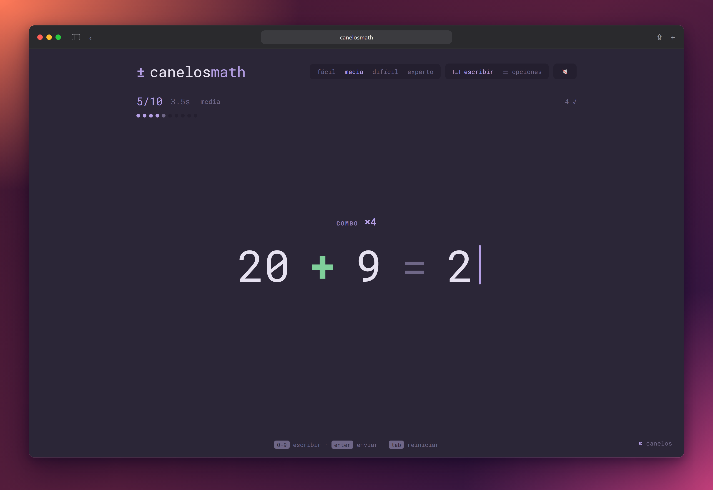
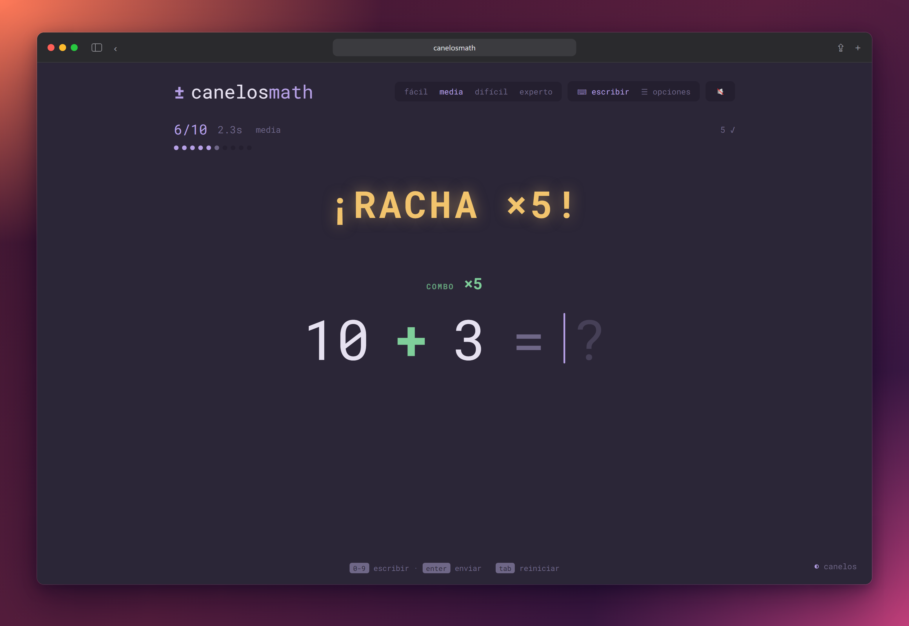
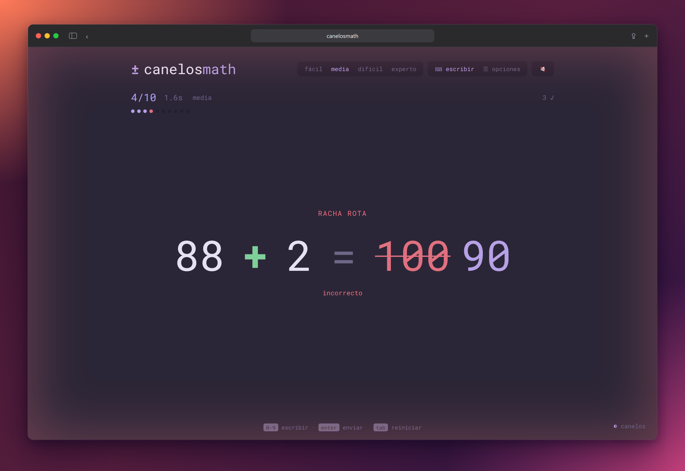
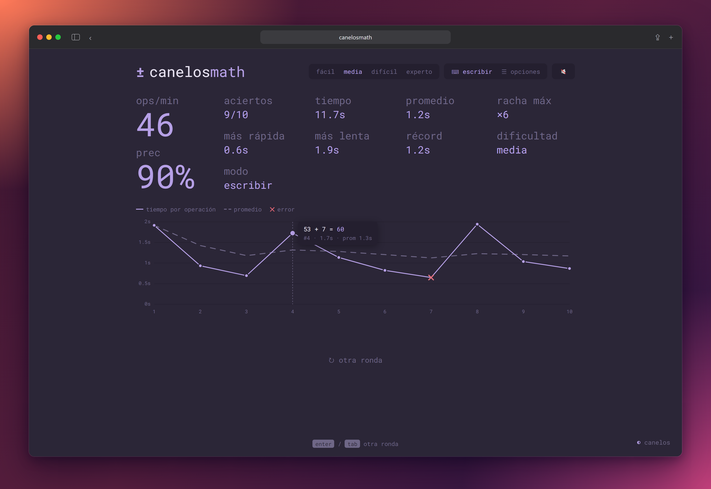
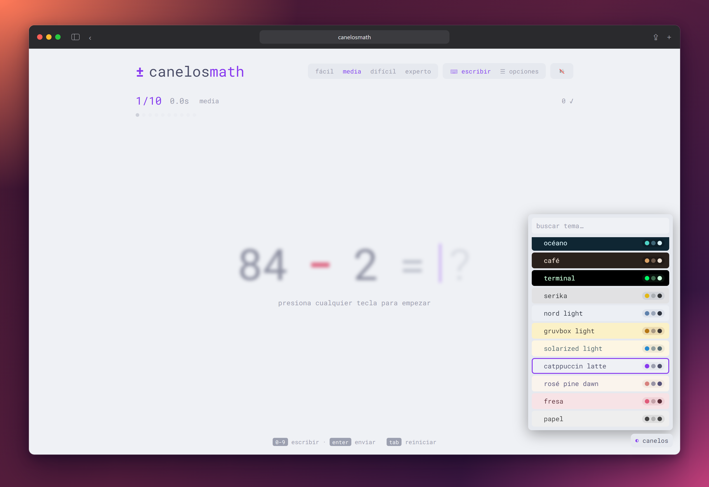
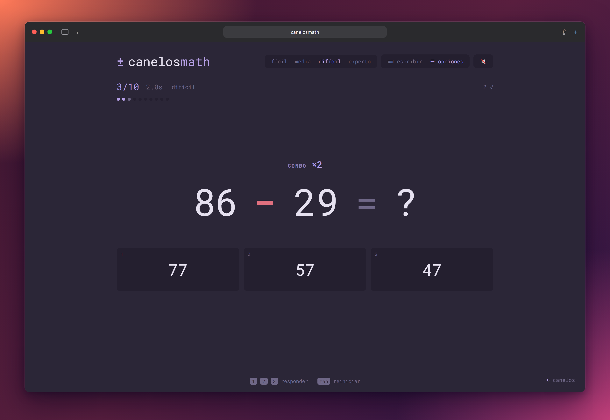
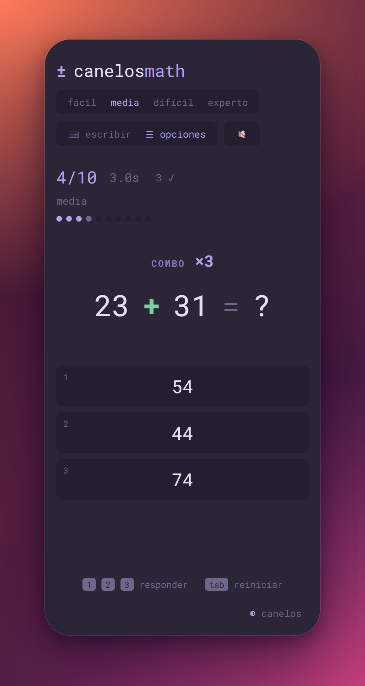
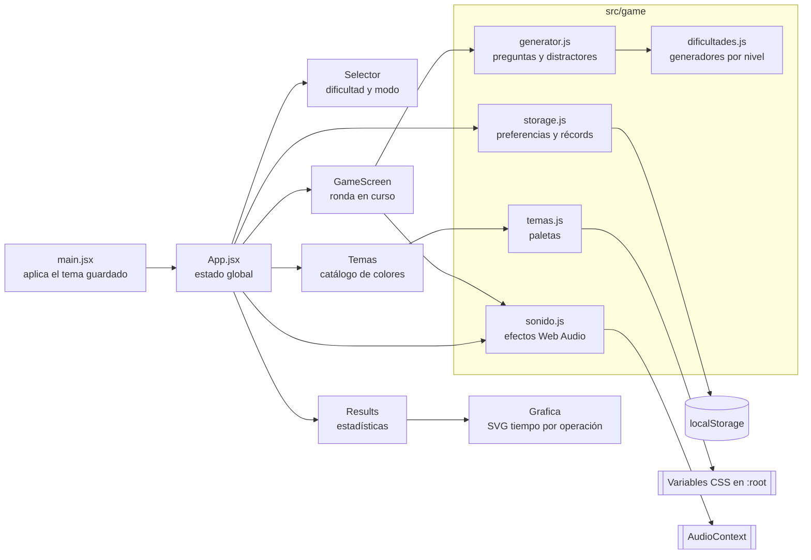
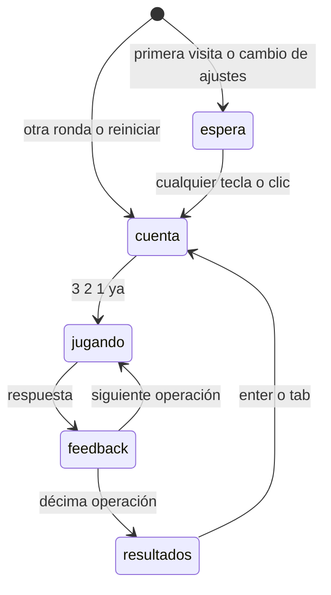
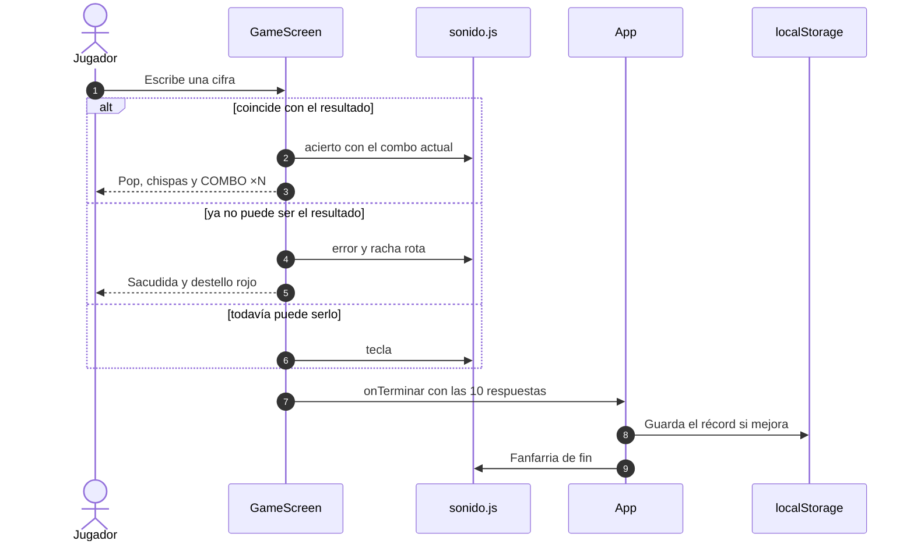

<!-- clsmd:start:intro -->
<div align="center">

# ± canelosmath

**Entrena cálculo mental con sumas y restas rápidas, al estilo de monkeytype y tetr.io.**


[Características](#-características) · [Arquitectura](#️-arquitectura) · [Instalación](#-instalación) · [Uso](#-uso)



</div>
<!-- clsmd:end:intro -->

<!-- clsmd:start:toc -->
## 📑 Contenido

- [Descripción](#-descripción)
- [Capturas](#-capturas)
- [Características](#-características)
- [Stack](#-stack)
- [Arquitectura](#️-arquitectura)
- [Cómo funciona una ronda](#-cómo-funciona-una-ronda)
- [Estructura del proyecto](#-estructura-del-proyecto)
- [Requisitos](#-requisitos)
- [Instalación](#-instalación)
- [Uso](#-uso)
- [Pruebas](#-pruebas)
- [Autor](#-autor)
<!-- clsmd:end:toc -->

<!-- clsmd:start:descripcion -->
## 📖 Descripción

canelosmath es un juego web para practicar **cálculo mental**. Cada ronda tiene 10 sumas y restas de la
dificultad elegida y no tiene límite de tiempo: el reloj solo mide cuánto tardas en cada operación.
Al terminar, muestra tus estadísticas y una gráfica del tiempo por operación, como la pantalla de
resultados de monkeytype.

La experiencia toma ideas de tetr.io: una cuenta regresiva antes de empezar, combos que suben de tono,
banners de racha, sacudidas de pantalla al fallar y sonidos sintetizados. Todo corre en el navegador,
sin backend ni cuentas. Las preferencias y los récords se guardan en `localStorage`.
<!-- clsmd:end:descripcion -->

<!-- clsmd:start:capturas -->
## 📸 Capturas

| Racha ×5 | Error y racha rota |
|:---:|:---:|
|  |  |
| **Resultados con gráfica** | **Catálogo de temas** |
|  |  |
| **Modo opciones** | **Móvil** |
|  |  |
<!-- clsmd:end:capturas -->

<!-- clsmd:start:caracteristicas -->
## ✨ Características

**Juego**
- Rondas de **10 operaciones** sin repetir, en cuatro dificultades:

  | Dificultad | Ejemplo | Tipo de operaciones |
  |---|---|---|
  | fácil | `7 + 8` | Sumas y restas de una cifra |
  | media | `47 + 8` | Dos cifras con una, y dos cifras sin llevar ni pedir prestado |
  | difícil | `82 − 47` | Dos cifras llevando o pidiendo prestado, tres cifras con dos |
  | experto | `615 − 278` | Tres cifras y miles |

- **Dos modos de respuesta**:
  - **escribir**: tecleas el resultado. Avanza solo al acertar y marca error en cuanto una cifra ya no puede formar el resultado.
  - **opciones**: eliges entre tres respuestas con `1` `2` `3` o con las flechas. Los distractores imitan errores típicos y comparten la última cifra para que no se pueda adivinar.
- **Sin límite de tiempo**: cuenta regresiva `3 · 2 · 1 · ¡ya!` y un cronómetro ascendente.

**Resultados**
- ops/min, precisión, aciertos, tiempo total, promedio, racha máxima, operación más rápida y más lenta.
- **Gráfica tipo monkeytype** en SVG: tiempo por operación, promedio acumulado y errores marcados con ✕. Al pasar el mouse muestra la operación y tu respuesta.
- **Récord** del mejor promedio por modo y dificultad, que solo cuenta con 7 aciertos o más.

**Efectos estilo tetr.io**
- Partículas y "pop" al acertar. Contador `COMBO ×N` que cambia de color al crecer.
- Banners en las rachas de 3, 5, 7 y 10 y "¡PERFECTO!" con 10/10.
- Al fallar: sacudida de pantalla, destello rojo en los bordes y "racha rota".
- Sonidos sintetizados con Web Audio, sin archivos: el tono del acierto sube con el combo. Se pueden silenciar con 🔊/🔇.
- Respeta `prefers-reduced-motion`.

**Personalización**
- **26 temas de color** (18 oscuros y 8 claros) con buscador y vista previa al pasar el mouse o usar las flechas.
- Tema, dificultad, modo y sonido se recuerdan entre visitas.
<!-- clsmd:end:caracteristicas -->

<!-- clsmd:start:stack -->
## 🧰 Stack

| Capa | Tecnología |
|---|---|
| Interfaz | [React 19](https://react.dev) con componentes de función y hooks |
| Build y servidor de desarrollo | [Vite 8](https://vite.dev) + `@vitejs/plugin-react` |
| Estilos | CSS plano con variables (`--bg`, `--main`, …) que cambian según el tema |
| Gráfica | SVG hecho a mano, sin librerías |
| Sonido | Web Audio API (osciladores y envolventes) |
| Persistencia | `localStorage` |
| Pruebas | [Vitest 5](https://vitest.dev) |
<!-- clsmd:end:stack -->

<!-- clsmd:start:arquitectura -->
## 🏗️ Arquitectura

Es una SPA sin backend. `App` guarda el estado global (modo, dificultad, récords, tema y sonido) y
alterna entre la pantalla de juego y la de resultados. La lógica que no depende de React vive en `src/game/`.



| Módulo | Responsabilidad | Ubicación |
|---|---|---|
| App | Estado global, registro de récords y sonidos de fin de ronda | [`src/App.jsx`](src/App.jsx) |
| GameScreen | Fases de la ronda, entrada por teclado, combos, animaciones y cronómetro | [`src/components/GameScreen.jsx`](src/components/GameScreen.jsx) |
| Results | Estadísticas animadas y atajos para otra ronda | [`src/components/Results.jsx`](src/components/Results.jsx) |
| Grafica | Gráfica SVG responsiva con tooltip | [`src/components/Grafica.jsx`](src/components/Grafica.jsx) |
| Temas | Panel de temas con búsqueda y vista previa | [`src/components/Temas.jsx`](src/components/Temas.jsx) |
| generator / dificultades | Operaciones por nivel, rondas sin repetir y distractores | [`src/game/`](src/game/) |
| storage | Lectura y escritura segura en `localStorage` | [`src/game/storage.js`](src/game/storage.js) |
| sonido | Síntesis de efectos y silencio global | [`src/game/sonido.js`](src/game/sonido.js) |
| temas | Catálogo de paletas y `aplicarTema()` | [`src/game/temas.js`](src/game/temas.js) |

**Datos guardados en el navegador**

| Clave de `localStorage` | Contenido |
|---|---|
| `calculo-rapido:modo` | `escribir` u `opciones` |
| `calculo-rapido:dificultad` | `facil`, `media`, `dificil` o `experto` |
| `calculo-rapido:records` | Mejor promedio en ms por `modo:dificultad` |
| `calculo-rapido:tema` | Id del tema elegido |
| `calculo-rapido:sonido` | `on` u `off` |

> [!NOTE]
> Las claves conservan el prefijo `calculo-rapido:` del nombre original del proyecto para no perder
> los récords guardados.
<!-- clsmd:end:arquitectura -->

<!-- clsmd:start:flujo -->
## 🔄 Cómo funciona una ronda



1. **espera**: hace falta un gesto del usuario para que el navegador permita el audio. La operación se ve difuminada.
2. **cuenta**: `3 · 2 · 1 · ¡ya!` con un pitido por paso. Al llegar a "¡ya!" empieza a medirse la primera operación.
3. **jugando y feedback**: cada respuesta guarda la operación, la respuesta, si fue correcta y los ms que tardó. La pausa de feedback (350 ms si aciertas, 1.1 s si fallas) no cuenta en el tiempo.
4. **resultados**: `App` calcula aciertos y promedio, actualiza el récord y reproduce la fanfarria.


<!-- clsmd:end:flujo -->

<!-- clsmd:start:estructura -->
## 📁 Estructura del proyecto

```
canelosmath/
├── index.html              # Punto de entrada y fuente Roboto Mono
├── vite.config.js          # Vite + plugin de React
├── src/
│   ├── main.jsx            # Monta la app y aplica el tema guardado
│   ├── App.jsx             # Estado global y cabecera
│   ├── index.css           # Estilos, animaciones y variables de tema
│   ├── components/         # GameScreen, Results, Grafica, Temas, Selector
│   └── game/               # Lógica sin React: generador, dificultades, storage, sonido, temas
├── docs/screenshots/       # Capturas del README
└── .clsmd/                 # Configuración para regenerar las capturas
```
<!-- clsmd:end:estructura -->

<!-- clsmd:start:requisitos -->
## 📋 Requisitos

- [Node.js](https://nodejs.org) **20.19 o superior** (o 22.12+), que es lo que pide Vite 8.
- npm, incluido con Node.
- Un navegador moderno. El sonido usa Web Audio y los estilos usan `color-mix()`.
<!-- clsmd:end:requisitos -->

<!-- clsmd:start:instalacion -->
## 🚀 Instalación

```bash
git clone git@github.com:angelcanelos/canelosmath.git
cd canelosmath
npm install
npm run dev
```

Abre la URL que muestra Vite (por defecto `http://localhost:5173`).
<!-- clsmd:end:instalacion -->

<!-- clsmd:start:uso -->
## 🎮 Uso

### Scripts

| Script | Qué hace |
|---|---|
| `npm run dev` | Servidor de desarrollo con recarga en caliente |
| `npm run build` | Build de producción en `dist/` |
| `npm run preview` | Sirve el build de `dist/` para probarlo |
| `npm test` | Ejecuta las pruebas con Vitest |

### Controles

| Tecla | Acción |
|---|---|
| Cualquier tecla | Empezar la ronda (pantalla de espera) |
| `0`–`9` | Escribir el resultado (modo escribir) |
| `Enter` | Enviar lo escrito (modo escribir) / otra ronda (resultados) |
| `1` `2` `3` o `←` `↓` `→` | Elegir respuesta (modo opciones) |
| `Tab` | Reiniciar la ronda / otra ronda |
| `↑` `↓`, `Enter`, `Esc` | Navegar, aplicar o cerrar el panel de temas |

> [!TIP]
> El build es estático: el contenido de `dist/` se puede publicar en cualquier hosting de archivos
> (GitHub Pages, Netlify, Vercel…).
<!-- clsmd:end:uso -->

<!-- clsmd:start:tests -->
## 🧪 Pruebas

```bash
npm test
```

Las pruebas de [`src/game/generator.test.js`](src/game/generator.test.js) comprueban:

- que todas las dificultades generan preguntas válidas, que fácil usa números de una cifra y que difícil lleva o pide prestado;
- que desde 20 los distractores comparten la última cifra con la respuesta y que también funcionan con resultados pequeños;
- que una ronda trae 10 preguntas sin repetir;
- que el récord solo se guarda con suficientes aciertos y si mejora el anterior.
<!-- clsmd:end:tests -->

<!-- clsmd:start:autor -->
## 👤 Autor

**angelcanelos**: [github.com/angelcanelos](https://github.com/angelcanelos)

<!-- TODO: agregar un archivo LICENSE y su sección si se quiere publicar con licencia -->
<!-- clsmd:end:autor -->
